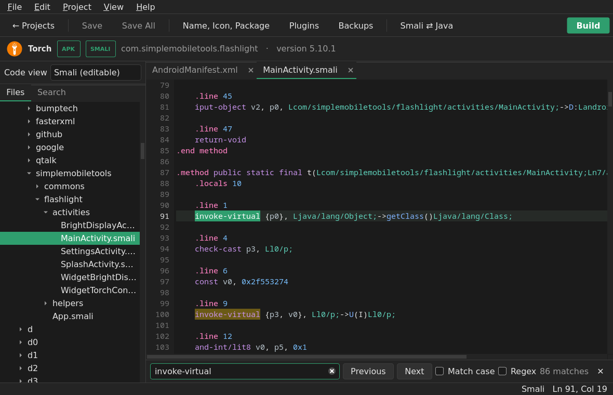
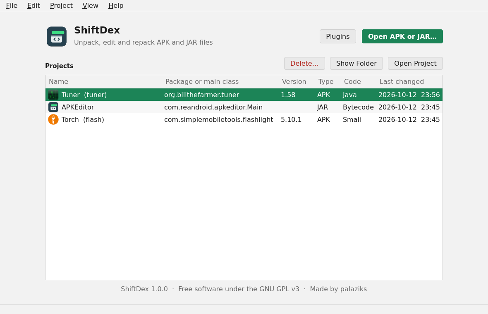
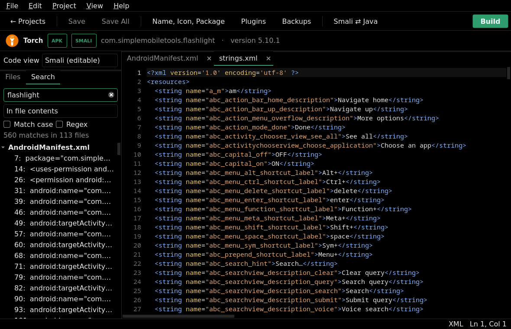
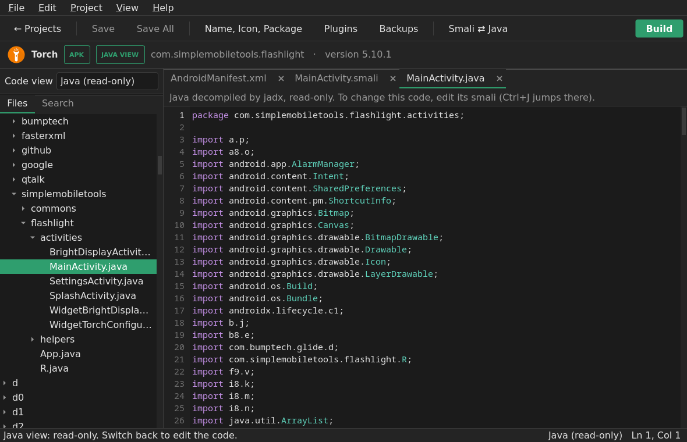
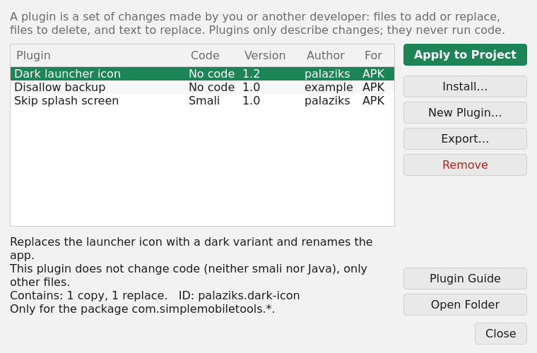
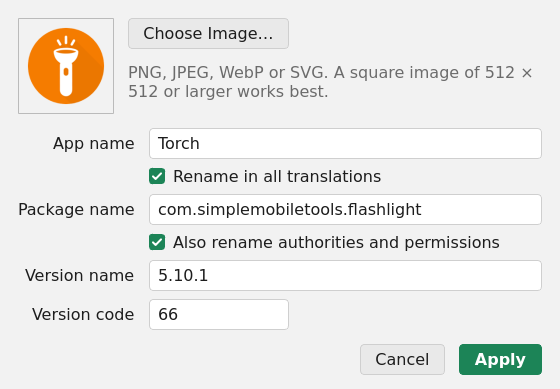

# ShiftDex

Unpack an APK or JAR, look around inside, change what you want, and pack it
again. ShiftDex is a desktop app for Linux that puts the whole round trip in
one window.



Made by palaziks. Free and open source software under the
[GNU General Public License v3](LICENSE).

## What it does

- **Unpack and build.** Open an `.apk` (or a split `.xapk`, `.apks`, `.apkm`)
  or a `.jar`, `.aar`, `.war`. APKs are decoded by
  [APKEditor](https://github.com/REAndroid/APKEditor) into smali code and
  readable XML, and built and signed again when you are done.
- **Smali or Java.** An app's code is shown as smali, which you can edit
  and build. One switch shows the same code as Java instead, decompiled by
  [jadx](https://github.com/skylot/jadx), for reading. Every project
  remembers which view it uses.
- **Browse and edit.** A file tree, tabs, and an editor with syntax
  highlighting for smali, XML, JSON, Java and properties files. Images are
  previewed, `.class` files are shown as bytecode, anything else as a hex
  dump. Find and replace in a file, search across every file of the project,
  or jump to a file by name.
- **Rename an app.** Change the app name, the launcher icon, the package
  name and the version in one dialog, without touching the manifest by hand.
- **Backups.** Snapshot the whole project before a risky change and go back
  to it later, keep copies of single files, and always have the untouched
  original to return to.
- **Plugins.** Pack your changes into a plugin and give it to someone else,
  who applies it to their own copy of the app. Plugins only describe changes
  (copy these files, delete those, replace this text); they never run code.
  Each plugin states whether it is a smali or a Java plugin, and ShiftDex
  always tells you which before you install or apply one.
- **Yours to set up.** White, black and AMOLED themes, and keyboard
  shortcuts you can change.

| | |
| --- | --- |
|  |  |
|  |  |
|  | |

## Install

You need a Linux desktop. Arch Linux, Debian, Ubuntu, Fedora, openSUSE and
the distributions built on them are supported.

```
git clone https://github.com/palazik/ShiftDex.git
cd ShiftDex
./install.sh
```

The installer shows which packages it is about to install with your package
manager (a compiler, CMake, Qt 6, Python and a JDK), asks before doing so,
builds ShiftDex and installs it for your user into `~/.local`, and fetches
the current APKEditor so the app is ready to use. ShiftDex then appears in
your application menu, and `.apk` and `.jar` files get an "Open with
ShiftDex" entry.

| Option | |
| --- | --- |
| `./install.sh --system` | install for all users into `/usr/local` |
| `./install.sh --prefix DIR` | install somewhere else |
| `./install.sh --no-deps` | skip the package manager; only build and install |
| `./install.sh --yes` | do not ask before installing packages |

To remove it: `./uninstall.sh` (add `--system` if that is how you installed
it). Your projects and settings are kept unless you add `--purge`.

Minimum versions: Qt 6.4, Python 3.9, Java 11. That covers Debian 12,
Ubuntu 24.04, Linux Mint 22, current Fedora and anything rolling. Ubuntu
22.04 is too old.

Building by hand, packaging and the layout of the source are described in
[docs/BUILDING.md](docs/BUILDING.md).

## First start

The first time you run ShiftDex it walks you through three short steps:

1. A welcome page.
2. **Tools.** ShiftDex checks for Java and makes sure APKEditor is there.
   The installer normally fetched it already; if not, ShiftDex downloads it
   by itself, here or the first time you open an APK. If your system has no
   `apksigner` (it comes with the Android SDK), you can download a signer
   here so that rebuilt APKs can be installed. jadx, for the Java view, is
   optional and can wait until you want it.
3. **Theme and projects folder.**

Everything can be changed later under **Edit > Preferences**. Tools are
stored in your user folder; nothing is installed system-wide.

## Using it

**Open a file** with the button on the start page, by dropping it on the
window, or from your file manager. ShiftDex copies it, unpacks it into a
project and shows the file tree. Your original file is never modified.

**Edit.** Double-click a file to open it. For an APK the interesting places
are:

- `AndroidManifest.xml`: permissions, activities, app-wide settings
- `smali/`: the app's code, one `.smali` file per class
- `resources/package_1/res/`: strings, layouts, images
- `root/`: everything else from the APK (`assets/`, `lib/`, …)

Right-click in the file tree to add, replace, rename, delete or back up
files.

**Build** with the button in the top right corner. ShiftDex asks where to
save the result, rebuilds the APK or JAR and, for APKs, signs it.

### Smali and Java

Android apps do not contain Java source. They contain compiled code, and
there are two ways to look at it:

- **Smali** is that code written out as text, one instruction per line. It
  is harder to read than Java, but it is exact: you can change it and build
  a working app from it. This is the view every project starts in.
- **Java** is what a decompiler reconstructs from the same code. It reads
  like the original source, but it is a best guess: it cannot be built back
  into the app, so in ShiftDex it is **read-only**.

Use them together. Read the Java to understand what a class does and find
the place you care about, then press `Ctrl+J` (or **Smali ⇄ Java** in the
toolbar) to jump to the same class in smali and make the change there.

The **Code view** box above the file list switches the whole project
between the two, at any time and in either direction. The choice is saved
with the project and shown in the project list and next to the project's
name.

The Java view is made by jadx, a 72 MB download that ShiftDex offers the
first time you ask for Java and that is not needed otherwise. Decompiling
takes from a few seconds to a few minutes depending on the app. The Java
does not follow your smali edits by itself; **Project > Update Java View**
decompiles again, from the project as it is now or from the original file.

For JAR files the same switch goes between the class files and their Java.

### About signing

Android refuses to install an APK whose signature does not match its
content, and editing an APK always breaks the original signature. ShiftDex
therefore signs what it builds, with a key it creates for you on first use
(or with your own keystore, set in Preferences > Building).

Because that key is not the original developer's, Android treats the result
as a different publisher's app: **uninstall the original app before
installing your build**, or change the package name so both can be
installed side by side. Apps that verify their own signature, or rely on
Google Play services tied to it, may notice the difference.

### Changing name, icon and package

**Project > App Name, Icon and Package** edits all of these at once. The
icon can be any PNG, JPEG, WebP or SVG; ShiftDex scales it to every size
the app uses and removes adaptive-icon definitions that would otherwise
override it.

Changing the package name updates the manifest and the resource table, and
by default also the app's provider authorities and custom permissions, so
your build can be installed next to the original. Classes are not moved or
renamed. If the app's code refers to its own package name or authority as
fixed text, search for the old name (**Search in All Files**) and adjust
those places.

This needs the APK to be decoded as XML, which is the default.

### Backups

**Project > Backups** has three kinds:

- **Snapshots** store the complete project. Restoring one brings every file
  back to that moment. ShiftDex takes one automatically before applying a
  plugin and before restoring, so a restore can itself be undone.
- **File backups** are copies of single files, made from the tree's context
  menu or with a shortcut.
- **Original file** is the untouched file you opened. You can save a copy
  of it or reset the project to it.

### Plugins

**Project > Plugins** lists installed plugins. Select one and press **Apply
to Project** to apply it, **Install…** to add a `.sdplugin` file someone
gave you, and **New Plugin…** to make one from the changes in the open
project.

Every plugin has a code type, shown in the list and again whenever you
install or apply one:

- a **smali** plugin changes an APK's smali code,
- a **Java** plugin changes the class files of a JAR,
- a plugin marked **no code** only touches other files, such as images and
  strings.

ShiftDex only offers a plugin where its code type fits: a smali plugin
needs an APK unpacked with smali, a Java plugin needs a JAR.

The full guide, with a step by step tutorial and the file format, is in
[docs/PLUGINS.md](docs/PLUGINS.md).

### JAR files

A JAR is unpacked as it is. Text files, resources and the manifest can be
edited, and files can be added, replaced or removed. `.class` files are
compiled code: ShiftDex shows their bytecode (this needs a full JDK, not
just a runtime), or their Java in the Java view, but cannot edit either as
text. To change a class, compile a
replacement and put the new `.class` file in its place with **Replace
With…**. Signature files of signed JARs are left out when rebuilding, since
they no longer match.

### Keyboard shortcuts

All of these can be changed in **Preferences > Shortcuts**.

| Action | Default |
| --- | --- |
| Open an APK or JAR | `Ctrl+O` |
| Save the current file | `Ctrl+S` |
| Save all files | `Ctrl+Shift+S` |
| Close the current tab | `Ctrl+W` |
| Go back to the project list | `Alt+Left` |
| Find in file | `Ctrl+F` |
| Find and replace | `Ctrl+H` |
| Go to line | `Ctrl+G` |
| Switch between smali and Java | `Ctrl+J` |
| Search in all files | `Ctrl+Shift+F` |
| Find a file by name | `Ctrl+P` |
| Build | `Ctrl+B` |
| Create a snapshot | `Ctrl+Shift+B` |
| Back up the current file | `Ctrl+Alt+B` |
| Show or hide the side panel | `F9` |
| Preferences | `Ctrl+,` |
| Quit | `Ctrl+Q` |

## Where your files are

| | |
| --- | --- |
| Projects and their backups | `~/.local/share/shiftdex/projects` (changeable in Preferences) |
| Installed plugins | `~/.local/share/shiftdex/plugins` |
| APKEditor, the signer and jadx | `~/.local/share/shiftdex/tools` |
| ShiftDex's signing key | `~/.local/share/shiftdex/keys` |
| Settings | `~/.config/shiftdex/config.json` |

Keep a copy of the signing key if you publish builds: updates to an
installed app must be signed with the same key.

## From a terminal

Everything the app does to a project is done by an engine that also works
on its own, which is handy for scripts:

```
export PYTHONPATH=~/.local/lib/shiftdex/engine
python3 -m shiftdex.cli create app.apk
python3 -m shiftdex.cli plugin-apply ~/.local/share/shiftdex/projects/app yourname.some-plugin
python3 -m shiftdex.cli build ~/.local/share/shiftdex/projects/app app_mod.apk
python3 -m shiftdex.cli --help
```

## How it is built

| Part | Language | Role |
| --- | --- | --- |
| `ui/` | C++ with Qt 6 | the application and editor |
| `native/` | C | fast search across a project's files |
| `jartool/` | Java | packing and unpacking JARs, class file disassembly |
| `engine/` | Python | projects, APKEditor, signing, backups, plugins |

See [docs/BUILDING.md](docs/BUILDING.md) for details and for how to run the
tests.

## A word on what to use it for

ShiftDex is a tool for working on software you are entitled to modify: your
own apps, open source apps, or apps whose licence and your local law allow
it. Respect other people's work and do not distribute modified apps you
have no right to distribute.

## Credits

- [APKEditor](https://github.com/REAndroid/APKEditor) by REAndroid does the
  decoding and building of APKs (Apache License 2.0). ShiftDex downloads it;
  it is not part of this repository.
- [jadx](https://github.com/skylot/jadx) by skylot produces the Java view
  (Apache License 2.0). Optional, downloaded on request.
- [uber-apk-signer](https://github.com/patrickfav/uber-apk-signer) by
  Patrick Favre-Bulle is the optional signer (Apache License 2.0), also
  downloaded on request.
- [Qt](https://www.qt.io/) is used under the LGPL.
- The app in the screenshots is Simple Flashlight by Simple Mobile Tools, an
  open source app.

## Licence

ShiftDex is free software: you can redistribute it and/or modify it under
the terms of the GNU General Public License as published by the Free
Software Foundation, either version 3 of the License, or (at your option)
any later version.

ShiftDex is distributed in the hope that it will be useful, but WITHOUT ANY
WARRANTY; without even the implied warranty of MERCHANTABILITY or FITNESS
FOR A PARTICULAR PURPOSE. See the [LICENSE](LICENSE) file for the full
text.

Copyright © 2026 palaziks
